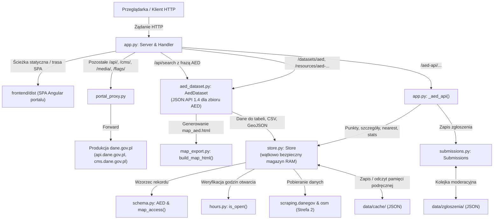

# Backend modułu „Mapa AED” / „System Ewidencji Zasobów AED” (Strefa 1)

Katalog `backend/` stanowi rdzeń serwerowy i logikę biznesową rozwiązania **„Misja AED – Dane na ratunek”**. Odpowiada za:
1. **Emulację zbioru danych portalu dane.gov.pl w standardzie JSON:API 1.4** (`aed_dataset.py`) – udostępnienie zbioru **„System Ewidencji Zasobów AED”** (`/pl/dataset/aed,system-ewidencji-zasobow-aed`) z pełną obsługą zasobów (Rejestr AED, Mapa AED, Zgłoś AED), widoku tabelarycznego z wyszukiwaniem/sortowaniem, pobieraniem plików CSV/GeoJSON/HTML, metadanych RDF/XML (DCAT-AP) oraz wstrzykiwaniem zbioru do globalnej wyszukiwarki portalu (`/api/search`).
2. **Udostępnianie dedykowanego API modułu AED** (`/aed-api/...`) – szybkie zapytania o punkty, kalkulacja dostępności „otwarte teraz”, algorytm wyszukiwania najbliższego AED w trybie ratunkowym, statystyki i moderacja zgłoszeń obywatelskich.
3. **Transparentne odwrotne proxy portalu** (`portal_proxy.py`) – przekazywanie zapytań systemowych (`/api/`, `/cms/`, `/media/`, `/flags/`) bezpośrednio do produkcyjnych usług `dane.gov.pl`.
4. **Serwowanie aplikacji frontendowej Angular** – dystrybucję plików z `frontend/dist` z obsługą routingu HTML5 History API dla aplikacji Single Page Application (SPA).
5. **Generowanie samodzielnej mapy HTML** (`map_export.py`) – tworzenie jednoplitowego, interaktywnego pliku mapy Leaflet do pobrania w trybie offline.
6. **Zarządzanie stanem i pamięcią podręczną** (`store.py`, `hours.py`, `schema.py`) – synchronizację wielowątkową, buforowanie dyskowe JSON oraz asynchroniczne odświeżanie danych w tle.

Całość oparta jest **wyłącznie na bibliotece standardowej Pythona 3.9+**, co eliminuje konieczność instalacji zewnętrznych pakietów czy baz danych (PostgreSQL, Elasticsearch, Redis).

---

## Architektura i przepływ danych

---

## Spis plików w katalogu `backend/`

| Plik | Rola |
| :--- | :--- |
| [`__init__.py`](file:///c:/Users/300538/PycharmProjects/tools-aed/aed-prototyp/backend/__init__.py) | Oznaczenie pakietu Pythona dla Strefy 1 backendu. |
| [`schema.py`](file:///c:/Users/300538/PycharmProjects/tools-aed/aed-prototyp/backend/schema.py) | Wzorcowy model rekordu AED, reguły walidacji współrzędnych i mapowanie słowników. |
| [`hours.py`](file:///c:/Users/300538/PycharmProjects/tools-aed/aed-prototyp/backend/hours.py) | Lekki parser reguł `opening_hours` wyznaczający dostępność defibrylatora „teraz”. |
| [`store.py`](file:///c:/Users/300538/PycharmProjects/tools-aed/aed-prototyp/backend/store.py) | Magazyn danych w pamięci RAM, indeksowanie, metryka Haversine, cache i eksport. |
| [`submissions.py`](file:///c:/Users/300538/PycharmProjects/tools-aed/aed-prototyp/backend/submissions.py) | Obsługa kolejki zgłoszeń obywatelskich z poszanowaniem zasad prywatności (RODO). |
| [`portal_proxy.py`](file:///c:/Users/300538/PycharmProjects/tools-aed/aed-prototyp/backend/portal_proxy.py) | Odwrotne proxy HTTP przekazujące ruch do produkcyjnych usług `dane.gov.pl`. |
| [`map_export.py`](file:///c:/Users/300538/PycharmProjects/tools-aed/aed-prototyp/backend/map_export.py) | Generator samodzielnego, interaktywnego pliku HTML z mapą AED (Leaflet). |
| [`aed_dataset.py`](file:///c:/Users/300538/PycharmProjects/tools-aed/aed-prototyp/backend/aed_dataset.py) | Pełna emulacja zbioru portalu w JSON:API 1.4, obsługa zasobów, widok tabelaryczny, DCAT-AP RDF i integracja z `/api/search`. |
| [`app.py`](file:///c:/Users/300538/PycharmProjects/tools-aed/aed-prototyp/backend/app.py) | Wielowątkowy serwer HTTP, routing zapytań, kompresja gzip, zabezpieczenia Windows oraz integracja wszystkich modułów. |

---

## Szczegółowy opis modułów, klas i funkcji

---

### 1. `schema.py`
Definiuje znormalizowany model rekordu defibrylatora AED, spójny dla wszystkich źródeł (dane.gov.pl, OpenStreetMap, formularz zgłoszeniowy). Nazewnictwo pól odpowiada wzorcowemu zakresowi danych.

#### Stałe i struktury
* **`FIELDS`** (`list[str]`): Kolejność 15 kolumn w eksporcie CSV:
  `id_aed`, `nazwa_obiektu`, `opis_lokalizacji`, `adres`, `szerokosc`, `dlugosc`, `wewnatrz`, `pietro`, `dostep`, `godziny_dostepnosci`, `dysponent`, `data_weryfikacji`, `zrodlo`, `zrodlo_url`, `licencja`.
* **`DOSTEP`** (`dict[str, str]`): Mapowanie kodów dostępu na czytelne polskie opisy (`publiczny`, `w_godzinach`, `ograniczony`, `prywatny`, `nieznany`).
* **`PL_BBOX`** (`tuple`): Prostokąt współrzędnych geograficznych Polski z buforem: `(min_lat=48.9, min_lon=14.0, max_lat=55.1, max_lon=24.3)`.
* **`AED`** (`@dataclass`): Kanoniczny rekord punktu AED:
  * Pola: `id_aed`, `szerokosc`, `dlugosc`, `zrodlo`, `zrodlo_url`, `licencja`, `nazwa_obiektu`, `opis_lokalizacji`, `adres`, `wewnatrz`, `pietro`, `dostep`, `godziny_dostepnosci`, `dysponent`, `data_weryfikacji`, `extra`.
  * **`to_dict(self) -> dict`**: Konwertuje rekord na słownik, usuwając wewnętrzne pole `extra`.

#### Funkcje
* **`in_poland(lat: float, lon: float) -> bool`**
  * Sprawdza, czy współrzędne mieszczą się w ramce `PL_BBOX`.
* **`to_float(value) -> float | None`**
  * Bezpieczna konwersja do typu zmiennoprzecinkowego. Obsługuje liczby, napisy z przecinkiem (np. `"52,22"`) oraz słowniki API `dane.gov.pl` zagnieżdżające wartość pod kluczami `"val"` lub `"repr"`.
* **`map_access(raw: str | None) -> str`**
  * Normalizuje ciągi tekstowe z tagów OSM (`yes`, `customers`, `private`, `permissive`) oraz polskich wariantów językowych na standardowy klucz ze słownika `DOSTEP`.

---

### 2. `hours.py`
Zoptymalizowany parser formatu `opening_hours` standardu OpenStreetMap. Wyznacza bieżący status dostępności bez instalacji zewnętrznych bibliotek.

#### Stałe i wyrażenia regularne
* **`DAYS`**: Lista skrótów dni tygodnia `["Mo", "Tu", "We", "Th", "Fr", "Sa", "Su"]`.
* **`_TIME`**: Wyrażenie regularne dopasowujące zakres godzin `HH:MM-HH:MM`.

#### Funkcje
* **`_parse_days(token: str) -> set[int] | None`**
  * Parsuje tokeny dni (np. `"Mo-Fr"`, `"Sa,Su"`, cykliczne `"Fr-Mo"`) na zbiór numerów dni tygodnia (0 = poniedziałek, 6 = niedziela).
* **`_parse_times(token: str) -> list[tuple[int, int]] | None`**
  * Konwertuje ciągi przedziałów czasowych na minuty od północy: `[(start, end), ...]`. Wartość `00:00` jako koniec przedziału jest traktowana jako koniec doby (1440 min).
* **`is_open(spec: str | None, now: datetime | None = None) -> bool | None`**
  * Główna funkcja wyznaczająca otwarcie obiektu:
    * `"24/7"` $\rightarrow$ `True`.
    * Pusty ciąg / brak specyfikacji $\rightarrow$ `None`.
    * Parsuje reguły rozdzielone średnikiem, obsługuje `"off"` / `"closed"`, pomija reguły świąt państwowych (`PH`).
    * Zwraca `True` (otwarty), `False` (zamknięty) lub `None` (nieznany/brak danych).

---

### 3. `store.py`
Centralny, wątkowo bezpieczny magazyn danych w pamięci operacyjnej. Zapewnia błyskawiczne zapytania przestrzenne, buforowanie i eksport.

#### Funkcje pomocnicze
* **`haversine_m(lat1: float, lon1: float, lat2: float, lon2: float) -> float`**
  * Wyznacza odległość ortodromiczną w metrach pomiędzy dwoma punktami GPS przy promieniu Ziemi $R = 6\,371\,000\text{ m}$.

#### Klasa `Store`
* **`__init__(self, base: Path, cfg: dict)`**: Inicjalizuje ścieżki cache (`data/cache/`), blokadę `threading.RLock`, słownik źródeł i listę rekordów.
* **`_rebuild(self)`**: Scalaja listy rekordów w deterministycznej kolejności (`danegov`, potem `osm`) i unieważnia cache punktów mapy.
* **`_save_cache(self, name: str, records: list[AED], report: list | None = None)`**: Atomowy zapis cache do `data/cache/{name}.json` przez plik tymczasowy `.tmp`.
* **`_load_cache(self, name: str) -> bool`**: Odczytuje zapisane rekordy z dysku, aktualizując stan magazynu.
* **`load_osm(self)`**: Wczytuje demonstracyjny plik GeoJSON OpenStreetMap (`material/PL.geojson`).
* **`refresh_danegov(self)`**: Asynchronicznie pobiera i indeksuje zbiory danych z produkcyjnego API `dane.gov.pl`.
* **`start(self)`**: Punkt startowy inicjalizacji: synchroniczny odczyt OSM i lokalnego cache `danegov`, a następnie uruchomienie wątku tła dla `refresh_danegov`.
* **`_open_code(self, r: AED, now: datetime) -> int`**: Zwraca kod otwarcia: `1` (otwarty), `0` (zamknięty), `-1` (nieznany).
* **`points_json(self) -> bytes`**: Generuje skompresowaną tablicę punktów dla mapy: `[lat, lon, zrodlo_idx, dostep_idx, open_code]` z 60-sekundowym cache'em in-memory.
* **`detail(self, idx: int) -> dict | None`**: Zwraca pełny słownik rekordu powiększony o wyliczoną dostępność i nazwę zbioru.
* **`nearest(self, lat: float, lon: float, n: int = 3, only_available: bool = True) -> list[dict]`**:
  * **Wyszukiwarka ratunkowa:** Wykorzystuje adaptacyjną ramkę współrzędnych ($\Delta\text{lat}$ od ok. 5,5 km rozszerzane 3x), odrzuca obiekty prywatne lub zamknięte (jeśli `only_available=True`) i precyzyjnie sortuje kandydatów metryką Haversine.
* **`stats(self) -> dict`**: Wylicza zagregowane liczniki (ogólna liczba, podział na źródła, dostępne w tej chwili, liczba zbiorów źródłowych).
* **`sources_info(self) -> dict`**: Zwraca status, licencje i raporty scrapingu dla każdego źródła.
* **`export_records(self) -> list[AED]`**: Zwraca rekordy dopuszczone do eksportu (wyłącznie `danegov`; wyklucza dane OSM ze względów licencyjnych ODbL).
* **`export_csv(self) -> bytes`**: Generuje plik CSV ze wzorcowym zakresem danych w kodowaniu UTF-8 z BOM (`\ufeff`) dla pełnej zgodności z MS Excel.
* **`export_geojson(self) -> bytes`**: Generuje kolekcję `FeatureCollection` w standardzie GeoJSON.

---

### 4. `submissions.py`
Obsługuje kolejkę moderacyjną dla propozycji nowych defibrylatorów zgłaszanych przez obywateli.

#### Stałe
* **`ALLOWED_FIELDS`**: Ścisła biała lista pól formularza: `szerokosc`, `dlugosc`, `nazwa_obiektu`, `opis_lokalizacji`, `godziny_dostepnosci`, `dostep`, `wewnatrz`, `pietro`, `dysponent`, `zgoda_regulamin`.

#### Klasa `Submissions`
* **`__init__(self, base: Path)`**: Inicjalizuje katalog `data/zgloszenia/` oraz blokadę `threading.Lock`.
* **`add(self, payload: dict) -> dict`**:
  * Waliduje obecność współrzędnych numerycznych oraz opisu lokalizacji.
  * Generuje unikalny identyfikator UUID (12 znaków hex).
  * Przypisuje status `"do_weryfikacji"` i znacznik czasu utworzenia.
  * Atomowo zapisuje zgłoszenie jako plik JSON w folderze kolejki.
  * **Prywatność:** Nie gromadzi żadnych danych osobowych (imion, nazwisk, e-maili, telefonów).
* **`list(self) -> list[dict]`**: Zwraca listę nadesłanych zgłoszeń posortowaną od najnowszych.

---

### 5. `portal_proxy.py`
Transparentne odwrotne proxy HTTP, umożliwiające lokalnemu frontendowi portalu pracę z prawdziwymi usługami zewnętrznymi.

#### Stałe i reguły
* **`ROUTES`**: Mapowanie lokalnych ścieżek na adresy produkcyjne:
  * `/api/` $\rightarrow$ `https://api.dane.gov.pl/1.4/`
  * `/cms/` $\rightarrow$ `https://cms.dane.gov.pl/`
  * `/media/` $\rightarrow$ `https://dane.gov.pl/media/`
  * `/flags/` $\rightarrow$ `https://dane.gov.pl/flags/`
* **`FORWARD_REQ`**: Bezpieczna biała lista nagłówków żądania (`Accept`, `Accept-Language`, `Content-Type`, `Authorization`, `X-Api-Version`). Ciasteczka nie są przekazywane.
* **`FORWARD_RESP`**: Biała lista nagłówków odpowiedzi (`Content-Type`, `Cache-Control`, `Last-Modified`, `ETag`, `Content-Disposition`).

#### Funkcje
* **`match(path: str) -> str | None`**: Sprawdza, czy ścieżka kwalifikuje się do przekazania przez proxy i zwraca docelowy URL.
* **`forward(method: str, target: str, headers, body: bytes | None, timeout: int = 30)`**: Wykonuje połączenie przez `urllib.request`. Zwraca krotkę `(status, headers, data)`. W razie braku połączenia lub błędu zwraca kod `502` z komunikatem w standardzie błędów API portalu.

---

### 6. `map_export.py`
Generator samodzielnej, interaktywnej mapy HTML (`mapa_aed.html`), dystrybuowanej jako zasób do pobrania w zbiorze danych.

#### Stałe
* **`TEMPLATE`**: Kompletny szablon HTML5 z osadzonymi stylami CSS, biblioteką Leaflet 1.9.4 z CDN, obsługą lokalizacji użytkownika (`navigator.geolocation`), rendererem Canvas oraz oknami Popup z linkiem nawigacyjnym „Prowadź do AED” (Google Maps pieszo).
* **`SOURCES`**: Lista nazw źródeł danych wyświetlanych na mapie.

#### Funkcje
* **`build_map_html(records, title: str, date: str, report_url: str) -> bytes`**
  * Konwertuje listę obiektów `AED` na zwięzłą tablicę JavaScript `[szer, dł, nazwa, opis, dostęp, godziny, źródło]`.
  * Zabezpiecza przed atakami XSS poprzez uciekanie znaków HTML i bezpieczną serializację znaczników zamykających skrypt (`<\/`).
  * Zwraca gotowy, samowystarczalny plik HTML zakodowany w UTF-8.

---

### 7. `aed_dataset.py`
Najbardziej rozbudowany komponent integracyjny. Emuluje zachowanie backendu portalu `dane.gov.pl` (zgodnie ze specyfikacją JSON:API 1.4), sprawiając, że zbiór **„System Ewidencji Zasobów AED”** jest renderowany przez natywne komponenty graficzne Angulara portalu, bez konieczności modyfikowania widoków zbiorów.

#### Stałe i konfiguracja
* **`DATASET_ID`**: Identyfikator zbioru (`"aed"`).
* **`SLUG`**: Slug zbioru (`"system-ewidencji-zasobow-aed"`). Pełny adres URL: `/pl/dataset/aed,system-ewidencji-zasobow-aed`.
* **`SEARCH_WORDS`**: Słowa kluczowe aktywujące zbiór w wyszukiwarce portalu: `aed`, `defibrylat`, `ewidencj`, `resuscytac`, `pierwsza pomoc`, `nagłe zatrzymanie`.
* **`TABLE`**: Definicja 13 kolumn widoku tabelarycznego rejestru (identyfikator, nazwa, adres, opis, szerokość, długość, wewnątrz, piętro, dostęp, godziny, dysponent, data weryfikacji, źródło).
* **`ORG_COLUMNS`**, **`RES_COLUMNS`**: Kolumny do generowania pliku metadanych zbioru CSV zgodnie ze schematem `DatasetResourcesCSVSerializer` z produkcyjnego backendu `mcod`.

#### Klasa `AedDataset`
* **`__init__(self, cfg: dict, store=None)`**: Inicjalizuje konfigurację zbioru na podstawie `config.json` (sekcja `zbior_aed`), wiąże referencję do `Store` oraz tworzy blokadę cache mapy.
* **`_records(self) -> list`**: Pobiera rekordy do rejestru. Domyślnie tylko oficjalne dane z `danegov`, a przy włączonej opcji `rejestr_osm_demo` także dane OSM.
* **`_row(r) -> dict`**: Przygotowuje sformatowany słownik pojedynczego wiersza tabeli.
* **`_data_date(self) -> str`**: Zwraca datę „Dane na dzień” (data ostatniego pobrania ze źródeł lub bieżąca data).
* **`_resource_defs(self, origin: str) -> list[dict]`**: Zwraca definicje 3 zasobów zbioru:
  1. *Rejestr AED* – plik CSV i GeoJSON z widokiem tabelarycznym.
  2. *Mapa AED* – interaktywny plik HTML do pobrania.
  3. *Zgłoś AED* – odnośnik do formularza zgłoszeniowego.
* **`_resource(self, d: dict, origin: str) -> dict`**: Formatuje pojedynczy zasób w standardzie JSON:API z relacjami do zbioru i tabeli danych.
* **`dataset(self, origin: str) -> dict`**: Generuje pełny dokument JSON:API opisujący zbiór danych (metadane, kategorie, częstotliwość aktualizacji, licencję CC0, relacje do instytucji i zasobów).
* **`resources(self, origin: str) -> dict`**: Zwraca kolekcję zasobów dla endpointu `/datasets/aed/resources`.
* **`history(self, page: int = 1) -> dict`**: Generuje historię zmian zbioru i zasobów dla zakładki „Historia zbioru”.
* **`structured_data(self, origin: str) -> dict`**: Generuje metadane Schema.org (JSON-LD) dla wyszukiwarek internetowych.
* **`metadata_csv(self, origin: str) -> bytes`**: Generuje plik CSV z pełnymi metadanymi zbioru, instytucji i zasobów (separator `;`, kodowanie UTF-8 BOM).
* **`metadata_rdf(self, origin: str) -> bytes`**: Generuje metadane w formacie RDF/XML zgodnie z europejskim profilem aplikacyjnym DCAT-AP.
* **`table(self, query: dict, origin: str) -> dict`**:
  * **Silnik widoku tabelarycznego rejestru (`/resources/aed-rejestr/data`):**
  * Obsługuje wyszukiwanie pełnotekstowe oraz zapytania po konkretnych kolumnach (np. `col1: Urząd AND col5: 52`).
  * Obsługuje sortowanie rosnące i malejące (`sort=col1` lub `sort=-col5` dla liczb).
  * Zapewnia stronicowanie wyników (`page`, `per_page`).
  * Zwraca nagłówki `headers_map` i schemat typów danych `data_schema`.
* **`register_csv(self) -> bytes`**: Generuje plik CSV z danymi rejestru AED.
* **`register_geojson(self) -> bytes`**: Generuje plik GeoJSON z danymi rejestru AED.
* **`map_html(self, origin: str) -> bytes`**: Zwraca wygenerowaną mapę HTML, buforowaną w pamięci przez 300 sekund.
* **`search_item(self, origin: str) -> dict`**: Formatuje zbiór AED jako element listy wyników wyszukiwarki portalu.
* **`search_matches(query: dict) -> bool`**: Sprawdza, czy zapytanie do `/api/search` zawiera słowa kluczowe związane z AED oraz czy pasuje do filtrów.
* **`patch_search(self, status: int, body: bytes, query: dict, origin: str) -> bytes | None`**:
  * Przechwytuje odpowiedź wyszukiwarki portalu i wstrzykuje zbiór AED na pierwszą pozycję listy wyników, korygując liczniki `meta.count` i agregacje `aggregations.counters.datasets`.
* **`handle(self, path: str, query: dict, origin: str)`**:
  * Główny dyspozytor URL dla emulowanego API zbioru (`/datasets/...`, `/resources/...`, `/histories`, `/catalog/...`). Zwraca `(status, content_type, body)` lub `None`, jeśli zapytanie dotyczy innego zasobu portalu.

---

### 8. `app.py`
Główny kontroler serwera HTTP integrujący wszystkie komponenty w jednym procesie.

#### Klasa `Handler(BaseHTTPRequestHandler)`
* **`_send(self, body: bytes, ctype: str, status=HTTPStatus.OK, extra: dict | None = None, compress=True)`**:
  * Wysyła odpowiedź HTTP. Automatycznie stosuje **kompresję GZIP** (dla odpowiedzi tekstowych/JSON > 1 KB przy obecności nagłówka `Accept-Encoding: gzip`). Dołącza nagłówek `X-Content-Type-Options: nosniff`.
* **`_json(self, obj, status=HTTPStatus.OK)`**: Pomocnik wysyłania odpowiedzi JSON z nagłówkiem `Cache-Control: no-store`.
* **`_body(self, limit: int) -> bytes`**: Bezpiecznie wczytuje ciało żądania do zadanego limitu bajtów (zapobiega atakom DoS).
* **`_origin(self) -> str`**: Ustala bazowy adres URL (`http://host`).
* **`_dataset_api(self, path: str, query: str) -> bool`**: Obsługuje zapytania emulowanego zbioru AED (`AedDataset`).
* **`_search_with_aed(self, url) -> bool`**: Przechwytuje i modyfikuje zapytania wyszukiwarki portalu `/api/search`.
* **`_route(self, method: str)`**: Główny router:
  1. Sprawdza prefiksy emulacji zbioru (`/api/1.4`, `/api`, `/aed-api/1.4`).
  2. Sprawdza zapytania wyszukiwarki `/api/search`.
  3. Obsługuje zapytania dedykowanego API `/aed-api/`.
  4. Przekazuje zapytania pasujące do reguł proxy portalu (`portal_proxy`).
  5. Serwuje pliki statyczne frontendu Angular (`_static`).
* **`_aed_api(self, method: str, p: str, q: dict)`**:
  * Obsługuje endpointy modułu AED (`/points`, `/aed/{idx}`, `/nearest`, `/sources`, `/stats`, `/zgloszenia`, `/export.csv`, `/export.geojson`, `/refresh`).
* **`_static(self, path: str)`**:
  * Serwuje zbudowany portal z `frontend/dist`.
  * **Obsługa SPA:** Jeżeli ścieżka nie odpowiada fizycznemu plikowi, serwuje `index.html`.
  * Zapobiega wyjściu poza katalog (`target.parents`).
  * Ustawia długoterminowe nagłówki cache dla plików z hashem i `no-cache` dla `index.html`.

#### Klasa `Server(ThreadingHTTPServer)`
* Wielowątkowy serwer HTTP.
* **`server_bind(self)`**: W systemie Windows wymusza opcję `socket.SO_EXCLUSIVEADDRUSE` i wyłącza wielokrotne bindowanie portu, eliminując problem z konfliktami procesów potomnych.

#### Funkcja `run`
* **`run(base: Path, cfg: dict, host: str, port: int, offline: bool, open_browser: bool = False)`**:
  * Konfiguruje typy MIME, tryb offline, instancje `Store`, `Submissions` i `AedDataset`.
  * Automatycznie testuje zapasowe porty (`8765`–`8784`), jeśli port domyślny jest zajęty lub zablokowany.
  * Zapisuje PID serwera do pliku `data/server.pid`.
  * Opcjonalnie uruchamia przeglądarkę i wchodzi w pętlę nasłuchiwania `serve_forever()`.

---

## Zestawienie endpointów API

### 1. Dedykowane API modułu AED (`/aed-api/...`)
| Metoda | Endpoint | Opis |
| :--- | :--- | :--- |
| `GET` | `/aed-api/points` | Kompaktowa tablica punktów dla mapy Leaflet. |
| `GET` | `/aed-api/aed/{idx}` | Pełne dane pojedynczego punktu AED. |
| `GET` | `/aed-api/nearest?lat=..&lon=..` | Najbliższe defibrylatory w trybie ratunkowym. |
| `GET` | `/aed-api/stats` | Liczniki i statystyki do banerów i nagłówków. |
| `GET` | `/aed-api/sources` | Status zintegrowanych źródeł danych. |
| `POST` | `/aed-api/refresh` | Wymuszenie ponownej synchronizacji ze źródłami. |
| `GET` | `/aed-api/export.csv` | Pobranie standaryzowanego rejestru w formacie CSV. |
| `GET` | `/aed-api/export.geojson` | Pobranie standaryzowanego rejestru w formacie GeoJSON. |
| `POST` | `/aed-api/zgloszenia` | Wysłanie nowego zgłoszenia AED do weryfikacji. |
| `GET` | `/aed-api/zgloszenia` | Pobranie listy zgłoszeń oczekujących na moderację. |

### 2. Emulowane API zbioru danych dane.gov.pl (JSON:API 1.4)
| Metoda | Endpoint | Opis |
| :--- | :--- | :--- |
| `GET` | `/api/search?q=aed` | Wstrzykiwanie zbioru AED na początek wyników wyszukiwania portalu. |
| `GET` | `/api/1.4/datasets/aed` | Metadane zbioru „System Ewidencji Zasobów AED”. |
| `GET` | `/api/1.4/datasets/aed/resources` | Lista zasobów (Rejestr AED, Mapa AED, Zgłoś AED). |
| `GET` | `/api/1.4/resources/aed-rejestr/data` | Dane tabelaryczne rejestru z filtrami, sortowaniem i stronicowaniem. |
| `GET` | `/api/1.4/resources/aed-rejestr/rejestr_aed.csv` | Pobieranie pliku CSV rejestru. |
| `GET` | `/api/1.4/resources/aed-rejestr/rejestr_aed.geojson`| Pobieranie pliku GeoJSON rejestru. |
| `GET` | `/api/1.4/resources/aed-mapa/mapa_aed.html` | Pobieranie samodzielnej mapy interaktywnej HTML. |
| `GET` | `/api/1.4/datasets/aed/resources/metadata.csv` | Metadane zbioru w formacie CSV portalu (`mcod`). |
| `GET` | `/api/1.4/catalog/dataset/aed.rdf` | Metadane zbioru w standardzie DCAT-AP RDF/XML. |
| `GET` | `/api/1.4/histories?row_id=aed` | Historia zmian i publikacji zbioru. |

---

## Zmiany w stosunku do wersji poprzedniej

W porównaniu do wcześniejszej wersji architektury backendu (złożonej z 4 stref z osobnym modułem wizyjnym oraz prostszej obsługi widoków) wprowadzono istotne zmiany optymalizacyjne i integracyjne:

1. **Pełna emulacja zbioru portalu dane.gov.pl (`aed_dataset.py`)**:
   * Zbiór **„System Ewidencji Zasobów AED”** stał się pełnoprawnym obiektem w strukturze portalu, renderowanym przez standardowe komponenty Angulara portalu (`/pl/dataset/aed,system-ewidencji-zasobow-aed`), bez konieczności modyfikacji widoków zbiorów.
   * Wdrożono pełną obsługę standardu **JSON:API 1.4** dla zasobów, widoku tabelarycznego z zaawansowanym sortowaniem/filtrowaniem (`/resources/aed-rejestr/data`), metadanych DCAT-AP RDF/XML, metadanych CSV portalu oraz historii publikacji.
   * Dodano mechanizm **przechwytywania i modyfikacji wyników wyszukiwarki portalu** (`/api/search`), który automatycznie pozycjonuje zbiór AED na pierwszym miejscu przy zapytaniach związanych z ratownictwem i defibrylatorami.
2. **Nowy moduł samodzielnej mapy do pobrania (`map_export.py`)**:
   * Stworzono generator samodzielnego pliku `mapa_aed.html`. Pozwala on użytkownikom pobrać interaktywną mapę działającą w przeglądarce w trybie offline (z obsługą geolokalizacji i wyznaczaniem trasy dojścia do najbliższego punktu).
3. **Usunięcie Strefy 4 (`vision/`) i uproszczenie zgłoszeń**:
   * Usunięto eksperymentalny moduł heurystycznej oceny zdjęć oraz zależność od biblioteki `Pillow`.
   * Formularz zgłoszeniowy (`submissions.py`) został uproszczony – skupia się na precyzyjnych koordynatach i opisie dostępności, a usunięto z niego obsługę przesyłania plików graficznych i endpoint `/aed-api/zdjecie`.
   * Backend stał się w 100% niezależny od bibliotek zewnętrznych – uruchamia się natychmiast na czystym Pythonie 3.9+.
4. **Rozszerzenie serwera HTTP w `app.py`**:
   * Serwer obsługuje teraz 4 główne role (API modułu AED, emulowane API zbioru portalu 1.4, proxy do produkcji oraz serwowanie frontendu).
   * Dodano metody `_dataset_api()`, `_search_with_aed()` oraz `_origin()` umożliwiające elastyczną współpracę z różnymi domenami i portami.
